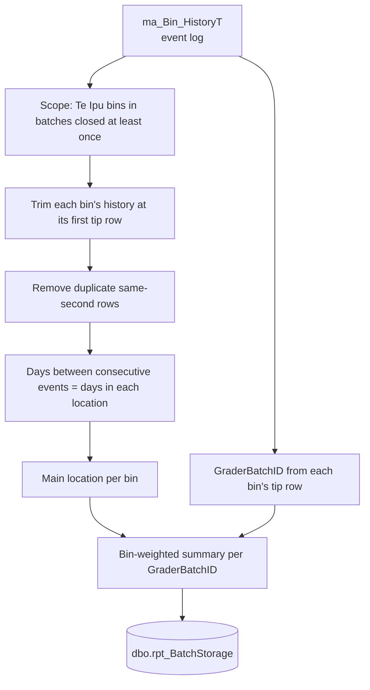

# Bin Storage Location by Grader Batch

Links where Te Ipu packed fruit was stored (and for how long) to the packing batch it was graded in, so that storage-affected defects such as **shrivel** can be analysed by `GraderBatchID`.

The source is the ABC Packer bin history (`ma_Bin_HistoryT`), which is an event log rather than a list of locations. This repository turns that log into:

1. the **time each bin spent in each storage location**,
2. the **main storage location of each bin** (where it spent the majority of its time), and
3. a **batch-level summary**: the main storage location and mean days in store for each `GraderBatchID`.

The final output is one row per batch in `dbo.rpt_BatchStorage`, refreshed nightly.

---

## Output

`dbo.rpt_BatchStorage` (primary key `SeasonID`, `GraderBatchID`):

| Column | Meaning |
|---|---|
| `SeasonID` | ABC Packer season |
| `GraderBatchID` | Packing batch (continuous across seasons) |
| `MainSite` | Storage site holding the largest share of the batch's bins |
| `MainType` | `CA` or `RA` for that main location (see [Limitations](#limitations-and-things-to-be-aware-of)) |
| `MainLocn` | Storage location (room) holding the largest share of the batch's bins |
| `FracBins` | Share of the batch's bins (0 to 1) whose main location is `MainLocn` |
| `MainLocnFlag` | `MainLocn` if `FracBins >= 0.5`, otherwise `Mixed` |
| `Bins` | Number of bins in the batch (bin weights; see below) |
| `MeanDaysInStore` | Mean days from the bin's first history record to its first tip, averaged over the batch's bins |
| `RefreshedAt` | When the row was last refreshed |

For shrivel analysis, `FracBins` should be kept alongside the location. A batch whose bins were spread across rooms has a weak "main location".

---

## How it works



### 1. Which bins are in scope

Bins are selected from `ma_BinT` where all of these hold:

- the bin has a `GraderBatchID` (it was tipped into a batch),
- the batch is in the chosen season (`SeasonID`) and packed at Te Ipu (`PackingCompanyID = 1`),
- the batch has been **closed at least once**, meaning there is a `Side = 'DR'` row in `ma_Grader_Batch_ChargeT`. A batch that was closed and then reopened for rework therefore stays in, while batches that were never closed are left out,
- the bin is not damaged (`BinDamageID IS NULL`).

Bins that are allocated to a batch's consignment but never tipped have no `GraderBatchID` and are not included.

### 2. Parsing the bin history (`ma_Bin_HistoryT`)

Each row of `ma_Bin_HistoryT` records something that happened to a bin: creation, a location change, a transfer between sites, a weight update, a tip. It does not say where the bin is, so location and time have to be derived from the sequence of rows.

Each row is joined to:

| Join | Gives |
|---|---|
| `sw_Location_RowT` → `sw_LocationT` | `StorageLocn` (room) and row |
| `sw_CompanyT` on `StorageSiteCompanyID` | `StorageSite` |
| `ma_Bin_DeliveryT` on `BinDeliveryID` | `StorageType`: `CA` when `StorageTypeID = 4`, otherwise `RA` |

The history has several quirks that the logic handles:

- **Two rows per move.** A location change writes two rows at the same second. Rows are de-duplicated per bin and timestamp, keeping the later one (highest `HistoryBinID`).
- **Blank locations are normal.** Creation, transfer, weight-update and tip rows often have no location. A location is **not** carried forward across a transfer, because the bin has left the room it was in. That time counts as "no location".
- **External sites have no rooms.** At sites other than Poporo Way and Te Ipu Packhouse (RO), such as Sunfruit, `StorageLocn` is blank. For these the **site name is used as the location**. At the two own sites a blank location is left blank, meaning not yet placed in a room.
- **Where the history stops.** The bin's history is cut at its **first tip row**, identified by `LastAction LIKE '%was tipped%'`, and uses that row's `HistoryBinID` as the cut-off. It is deliberately not cut by `TippedDatetime`. In the original extract, about 3% of bins had a tip row 1 second later than `TippedDatetime`, which dropped the tip row and extended the final location out to the present. Some bins also have another row at the same second as the tip but with a higher ID, so the cut is applied *before* the same-second de-duplication.
- **Re-tips.** Bins tipped more than once (same batch, or rarely a second batch) use the first tip for timing.

**Days in each location.** After cleaning, each event row holds until the next event. The duration of a row is the time to the next row, in days (`seconds / 86400`). The tip row is last and contributes zero. Durations are summed per bin and location.

### 3. Where a bin spent the majority of its time

For each bin, the **main location** is the room (or external site) with the most days, ignoring:

- time with no location, and
- the **Smartfresh** treatment rooms, which are short treatment steps and not storage.

`FracInMain` (main-location days divided by the bin's total days) is kept for diagnostics. Ties are broken alphabetically by location so the result is stable.

`MeanDaysInStore` uses the bin's *total* days, including no-location and Smartfresh time.

### 4. From consignments (`BinDeliveryID`) to batches (`GraderBatchID`)

Fruit arrives as consignments (`BinDeliveryID`), and the relationship between consignments and batches is many-to-many: one consignment can be tipped across several batches, and one batch is fed by many consignments. A delivery-to-batch mapping is therefore ambiguous about which bins went where.

The approach used here avoids that ambiguity by working at **bin level**:

- every tipped bin has the `GraderBatchID` recorded on its tip row in `ma_Bin_HistoryT`, so each bin has an exact batch;
- 12 bins in the data were tipped on two different consecutive batches (a changeover during a tipping run). These are split 50:50 across both batches, so every bin's weights sum to 1;
- consignment-level logic is not needed for the main output. The consignment appears in the data only as a carried-through key.

Background on the consignment mapping (kept for cross-checking):

- Across the mapping, `GraderBatchNo` (resets each season, free text in `LastAction`) and `GraderBatchID` (continuous) are one-to-one.
- `GraderBatchNo` is offset by packing site: Te Ipu batches are 1 to ~818, and other sites are 5000+, 8000+ and 9000+.
- Fruit packed at other sites is never tipped in ABC Packer and so is outside this analysis.
- The `LastAction` text ("Bin was tipped on Grader Batch No 440") agreed with the mapping for every tipped bin checked, but the `GraderBatchID` column on the tip row is the authoritative source.

### 5. Batch-level summary

For each `GraderBatchID`:

1. Group the batch's bins by their main location, summing bin weights, to get the number of bins in each location.
2. `FracBins` is the share of bins in the top location, which becomes `MainSite` / `MainType` / `MainLocn`.
3. `MainLocnFlag` is `Mixed` if `FracBins < 0.5`.
4. `MeanDaysInStore` is the bin-weighted mean of each bin's total days.

All bins are weighted equally (not by kg).

---

## Running it

The logic is the stored procedure `dbo.usp_Refresh_BatchStorage`:

```sql
EXEC dbo.usp_Refresh_BatchStorage @SeasonID = 2013, @PackingCompanyID = 1;
```

It builds temporary tables in five steps (`#hist`, `#bin_loc`, `#bin_batch`, `#bin_main`, then the batch result) and replaces that season's rows in `dbo.rpt_BatchStorage` inside a single transaction. A failed run therefore leaves the previous results in place.

### Nightly refresh

An Azure Data Factory pipeline runs the procedure on a daily schedule (New Zealand time), with a failure alert. The pipeline's identity needs `EXECUTE` on the procedure only.

### Reading the results

From R:

```r
library(DBI)
con <- dbConnect(odbc::odbc(), dsn = "<your-dsn>")
batch_storage <- dbGetQuery(con, "SELECT * FROM dbo.rpt_BatchStorage WHERE SeasonID = 2013")
```

### Snowflake

The data is being migrated to Snowflake (`ROCKIT_DATA_PROD.ABCPACKER.ODS_*` tables). The same logic is written as a single CTE view, with a table refreshed by a Snowflake task for downstream apps. The main syntax differences from SQL Server are `DATEDIFF('second', ...)` instead of `DATEDIFF(SECOND, ...)`, `ILIKE`, and `CREATE TEMPORARY TABLE ... AS` in place of `SELECT ... INTO #t`.

---

## Repository layout

> Adjust to match the actual files.

```
sql/
  create_rpt_BatchStorage.sql      -- results table
  usp_Refresh_BatchStorage.sql     -- stored procedure (SQL Server / Azure SQL)
snowflake/
  v_batch_storage.sql              -- view with the same logic
  task_refresh_batch_storage.sql   -- scheduled refresh
R/
  ...                              -- exploration / validation scripts
```

---

## Limitations and things to be aware of

- **`StorageType` comes from the delivery, not the room.** A bin can be labelled `CA` while sitting in a room that is by name a regular-atmosphere coolstore (for example `PRA3`). Check this before using `MainType` as a CA/RA exposure variable, or derive the type from the room name instead.
- **Tipped bins only.** Bins never tipped on a batch are excluded. Bins in batches that have never been closed (still in progress) are excluded too, so the newest batches appear only after they close.
- **Reopened batches.** Batches closed once and reopened for rework stay in, and bins tipped later on those batches will join them on the next refresh.
- **Bins are weighted equally.** Shrivel rates are really per-kg, so weight by bin weight if that matters.
- **Tip detection uses the `LastAction` text** (`was tipped`). If the wording changes, the tip cut-off and bin-to-batch link will stop working, so check the bin counts if ABC Packer is upgraded.
- **Own-site names are hard-coded** (`Poporo Way`, `Te Ipu Packhouse (RO)`) in the rule that fills external-site locations. Add any new own site to that list.
- **Season and packing site** are parameters of the procedure, but the Snowflake view hard-codes them in the scope step.

### Sanity checks

- The sum of bin weights should equal the number of in-scope tipped bins, and every bin's weights should sum to 1.
- `Bins` per `GraderBatchID` should be close to the grader's own bin count for the batch.
- When this was built (early Oct 2026): 44,844 bins and 799 batches for Te Ipu, season 2013, with the median batch containing about 49 bins.

---

## Data sources

| Table | Used for |
|---|---|
| `ma_Bin_HistoryT` | Event log: locations, transfers, tips |
| `ma_BinT` | Bin to `GraderBatchID`, damage flag |
| `ma_Grader_BatchT` | Season and packing site of the batch |
| `ma_Grader_Batch_ChargeT` | "Closed at least once" test (`Side = 'DR'`) |
| `ma_Bin_DeliveryT` | `StorageTypeID` (CA / RA) |
| `sw_Location_RowT`, `sw_LocationT` | Location (room) and row |
| `sw_CompanyT` | Storage site name |
# StorageLocationByBatch
